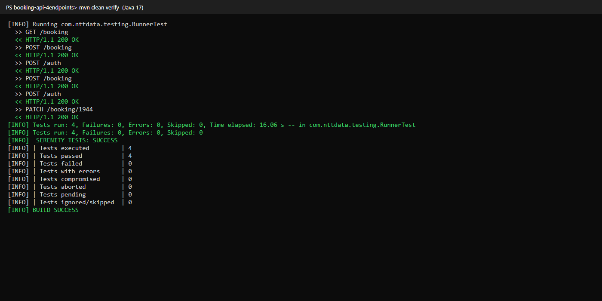
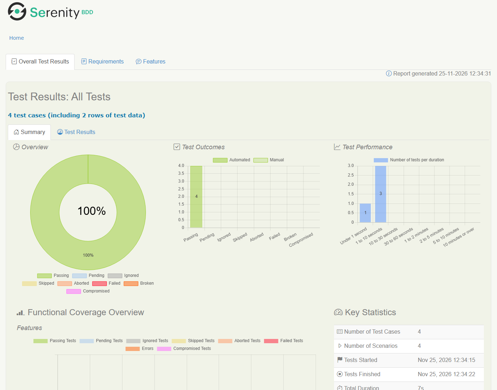
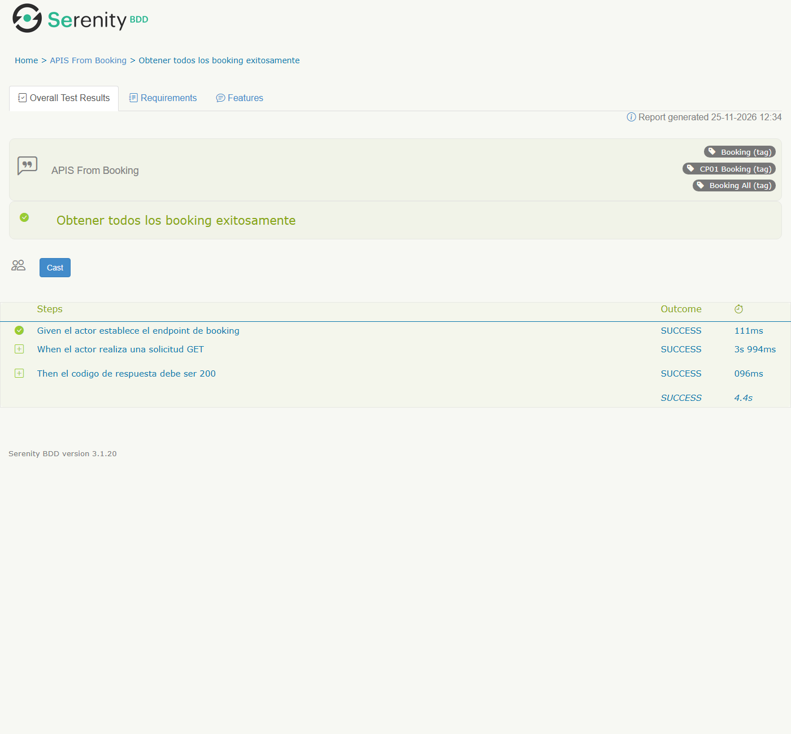
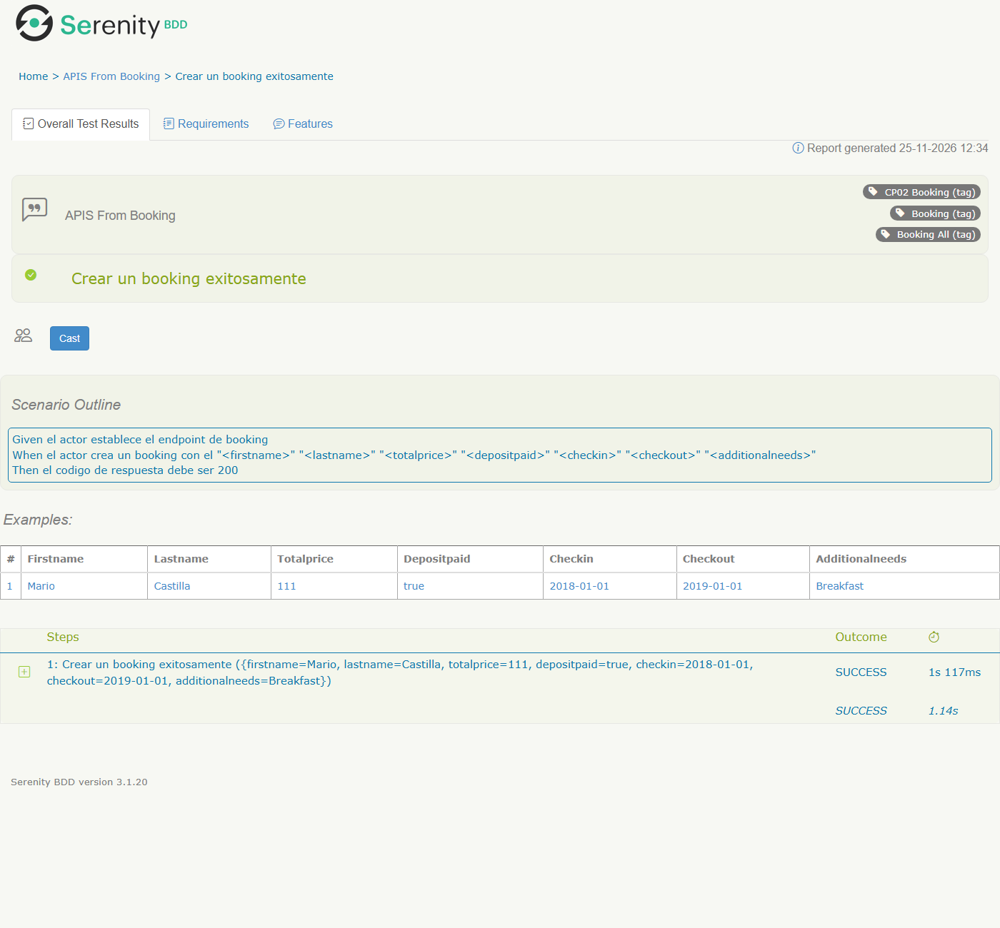
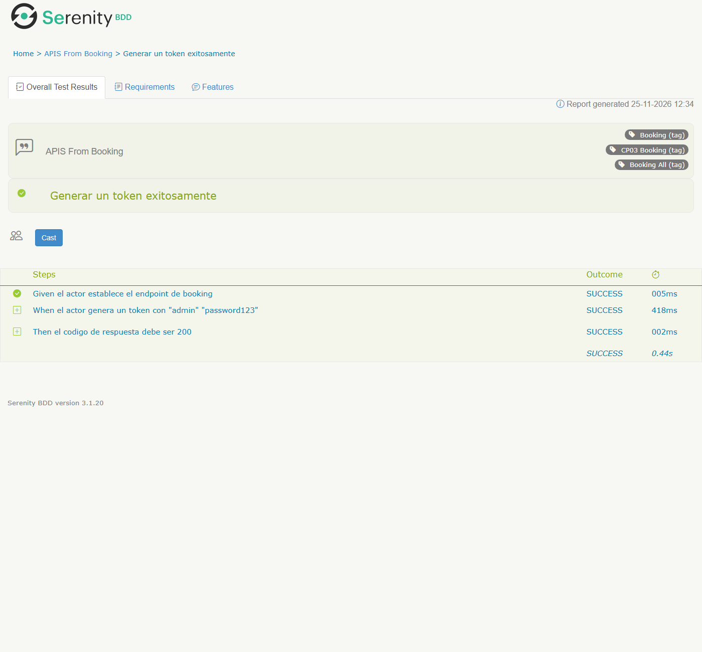
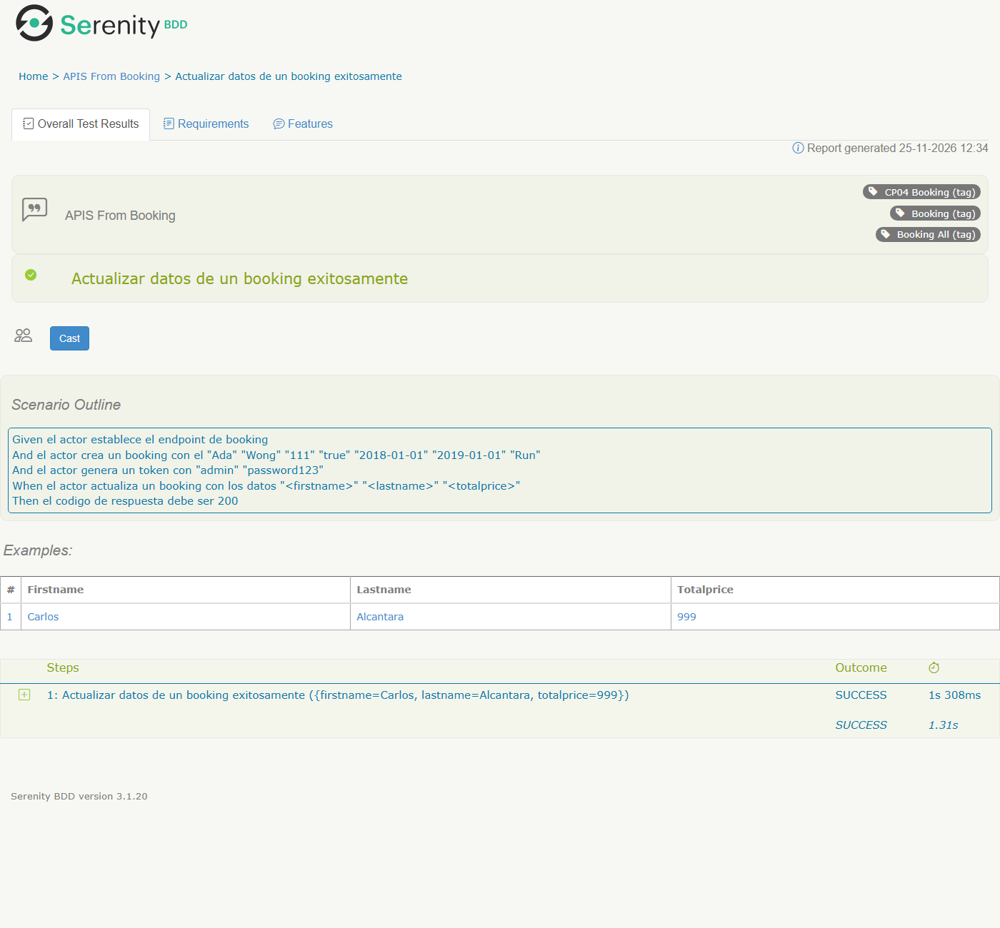

# Contrato de API | Clase 05 | NTT DATA


## Datos generales

| | |
|---|---|
| **URL base** | `https://restful-booker.herokuapp.com` |
| **Formato** | JSON |
| **Header obligatorio** | `Accept: application/json` (si se envía otro valor, la API responde **418**) |
| **Autenticación** | Solo para PATCH: cookie `token=<token>` obtenido en `POST /auth` |

---

## Endpoint 1 – Listar bookings

| | |
|---|---|
| **Método / ruta** | `GET /booking` |
| **Headers** | `Content-Type: application/json` |
| **Body** | — |
| **Caso de prueba** | `@CP01_Booking` – Obtener todos los booking exitosamente |
| **Clase** | `tasks/GetAllBookings.java` |

**Respuesta esperada – 200 OK**

```json
[
  { "bookingid": 1 },
  { "bookingid": 2 },
  { "bookingid": 3 }
]
```

---

## Endpoint 2 – Crear booking

| | |
|---|---|
| **Método / ruta** | `POST /booking` |
| **Headers** | `Content-Type: application/json`, `Accept: application/json` |
| **Caso de prueba** | `@CP02_Booking` – Crear un booking exitosamente |
| **Clase** | `tasks/PostBooking.java` |

**Request**

```json
{
  "firstname": "Mario",
  "lastname": "Castilla",
  "totalprice": 111,
  "depositpaid": true,
  "bookingdates": {
    "checkin": "2018-01-01",
    "checkout": "2019-01-01"
  },
  "additionalneeds": "Breakfast"
}
```

**Respuesta esperada – 200 OK**

```json
{
  "bookingid": 1929,
  "booking": {
    "firstname": "Mario",
    "lastname": "Castilla",
    "totalprice": 111,
    "depositpaid": true,
    "bookingdates": { "checkin": "2018-01-01", "checkout": "2019-01-01" },
    "additionalneeds": "Breakfast"
  }
}
```

El `bookingid` se guarda en el actor (`remember("bookingId")`) para usarlo en el PATCH.

---

## Endpoint 3 – Generar token

| | |
|---|---|
| **Método / ruta** | `POST /auth` |
| **Headers** | `Content-Type: application/json` |
| **Caso de prueba** | `@CP03_Booking` – Generar un token exitosamente |
| **Clase** | `tasks/PostToken.java` |

**Request**

```json
{
  "username": "admin",
  "password": "password123"
}
```

> Son las credenciales públicas de demo que publica Restful Booker.

**Respuesta esperada – 200 OK**

```json
{
  "token": "a13a4fde9ab602c"
}
```

El `token` se guarda en el actor (`remember("token")`) para usarlo en el PATCH.

---

## Endpoint 4 – Actualizar booking (parcial)

| | |
|---|---|
| **Método / ruta** | `PATCH /booking/{id}` |
| **Headers** | `Content-Type: application/json`, `Accept: application/json`, `Cookie: token=<token>` |
| **Precondición** | Haber creado un booking (Endpoint 2) y generado un token (Endpoint 3) |
| **Caso de prueba** | `@CP04_Booking` – Actualizar datos de un booking exitosamente |
| **Clase** | `tasks/PatchBooking.java` |

**Request** – `PATCH /booking/1944`

```json
{
  "firstname": "Carlos",
  "lastname": "Alcantara",
  "totalprice": 999
}
```

**Respuesta esperada – 200 OK** (devuelve el booking completo ya actualizado)

```json
{
  "firstname": "Carlos",
  "lastname": "Alcantara",
  "totalprice": 999,
  "depositpaid": true,
  "bookingdates": { "checkin": "2018-01-01", "checkout": "2019-01-01" },
  "additionalneeds": "Run"
}
```

---

## Códigos de respuesta observados

| Código | Cuándo |
|---|---|
| **200** | Petición correcta (los 4 endpoints) |
| **418** | El header `Accept` no es exactamente `application/json` (me pasó al usar `.accept(ContentType.JSON)`) |
| **405** | PATCH a `/booking/null`, cuando no se llegó a crear el booking antes |

---

## Evidencias

Ejecución con Java 17: **4 tests ejecutados, 4 pasaron, 0 fallaron.**

**Consola – `mvn clean verify`**



**Reporte Serenity**



**CP01 – GET /booking**



**CP02 – POST /booking**



**CP03 – POST /auth**



**CP04 – PATCH /booking/{id}**


